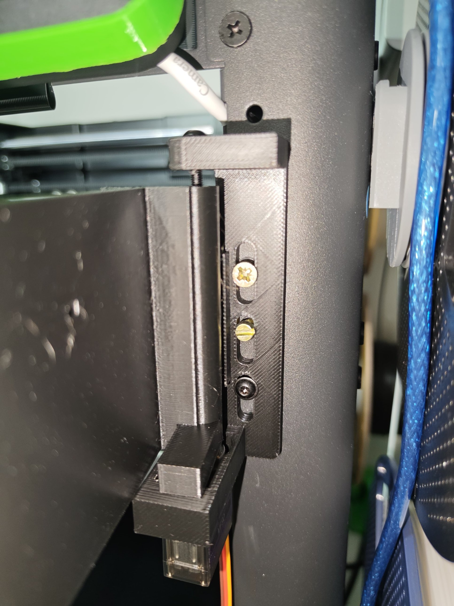

# AD5X · Barrido automático de la cama con espátula

Impresión en serie para la **Flashforge AD5X con ZMOD**. Al terminar cada trabajo de la cola de Moonraker, la impresora:

1. Enfría la cama.
2. Despliega con un servo un soporte abatible y engancha una espátula en el cabezal, con una cola de milano.
3. Empuja las piezas fuera de la cama, por el borde delantero.
4. Deja la espátula, pliega el soporte y lanza la siguiente impresión.

Las piezas demasiado altas, las de materiales que se pegan demasiado o las que no se despegan se quedan en la cama. En esos casos **la cola se pausa** para que las retires a mano.

- Modelos para imprimir en Printables: <https://www.printables.com/model/1927461-ad5x-barrido-automatico-de-la-cama-con-espatula>
- Repositorio: <https://github.com/devcheny/ad5x-barrido-cama/>



> Proyecto personal probado en una sola máquina. Úsalo bajo tu responsabilidad, vigila las primeras impresiones y **calibra las posiciones en tu impresora** antes de dejarla sola.

---

## Funciones

| | |
|---|---|
| **Solo barre cuando es seguro** | Piezas de hasta 80 mm de alto a ras de cama (`ALTURA_MAX`, lo que cabe bajo el puente delantero). De 80 a 150 mm (`ALTURA_TOPE`) hace una primera ronda con la cama más baja, para que la pieza pase bajo el puente, y otra a ras de cama para la línea de purga. Siempre dentro del alcance de la espátula. |
| **Sabe dónde están las piezas** | El G-code final guarda la altura, el material y la zona que ocupan las piezas (`EXCLUDE_OBJECT`) antes de que ZMOD borre la lista. Solo hace las pasadas necesarias y entra justo detrás de las piezas. |
| **Empuje lento para PETG/PCTG** | 5 mm/s en lugar de 15 mm/s: el motor tiene más fuerza y es más difícil que pierda pasos. |
| **Detección de piezas pegadas** | Empuja en tramos de 5 mm y lee la **báscula de la cama** (`weightValue`). Si sube más de +300 y sigue alta 4 s después, lo trata como atasco. Levanta la espátula y espera 5 min antes de reintentar, hasta 3 veces. Si la pieza no se suelta, deja la espátula y pausa la cola. Un pico breve al despegar no cuenta como atasco. |
| **Home tras cada pasada** | `G28.1 X/Y`, que recupera los pasos perdidos al empujar. |
| **Respeta la palanca de la papelera** | Por detrás de Y 220 solo se mueve en línea recta en Y, nunca en X. |
| **Soporte abatible** | El soporte solo se pone recto para coger o dejar la espátula. El resto del tiempo está plegado hacia fuera, así que se aprovecha toda la anchura de la cama. |
| **Cama más fría al terminar** | Con los `M73` de Orca, cuando pasa del 50 % y faltan ≤ 10 min, baja la cama un 25 %. Así se enfría antes y la pieza se suelta mejor. |
| **Compatible con ZMOD** | Desvía los recorridos de ZMOD por el borde delantero a Y 4, para que no enganchen la espátula aparcada. |

---

## Material necesario

- Flashforge **AD5X** con **ZMOD 1.7.6** o posterior, Fluidd y Moonraker (los que trae ZMOD).
- **Arduino Uno**: original o clon CH340. Hace de segunda placa de Klipper.
- **Servo MG90S**, con engranajes metálicos.
- Alimentación del servo: fuente de 5 V aparte (reductor de 24→5 V o cargador USB) **o** el 5 V del Uno con un condensador de 470–1000 µF. Lee la sección de conexiones.
- **11 imanes de neodimio de 6×2 mm**:
  - tapa: 3 (2 de sujeción y 1 de retención en la cola de milano);
  - espátula: 4 (retención, 2 de aparcado y 1 para el sensor Hall);
  - puerta: 3 (2 de la cuna y 1 de retén);
  - base: 1 (retén).
- Tornillería:
  - 1 × M3×20 como eje de la bisagra (rosca directamente en el brazo superior de la base);
  - 3 tornillos para el pilar delantero derecho: el que ya trae la impresora y los 2 agujeros libres de debajo, unos 4 mm más largos que el original, con arandela;
  - los tornillos que vienen con el servo.
- Opcional: sensor Hall **A3144**, para comprobar que la espátula está en el soporte.
- Filamento **PETG** para todas las piezas.

---

## Piezas impresas (`modelos/`)

| Archivo | Qué es |
|---|---|
| `tapa_v5` | Tapa frontal del cabezal con la cola de milano (con punta de entrada) y alojamientos para imanes de 6×2. Panal de ventilación cerrado, columnas del ventilador cónicas de Ø4,2 y placa del ventilador 0,8 mm más alta. |
| `espatula_v5` | Espátula de 65 mm con la ranura en cola de milano, embudo de entrada y alojamientos de Ø6,6 para imanes (con chaflán para compensar la pata de elefante). |
| `puerta_soporte` | Cuna abatible donde se aparca la espátula, con la bisagra, el hueco para el brazo simple del servo y rebajes de entrada en la pared del lado de la cola. |
| `base_servo` | Base fija al pilar: brida con tres ranuras cortas (una por tornillo del pilar, con ajuste en altura), tope de la posición recta con imán, brazo superior para la bisagra y repisa del servo. |

En cada carpeta:

- `stl/` para imprimir.
- `step/` para modificar.
- `3mf/ad5x_barrido_completo.3mf`: proyecto de OrcaSlicer con todas las piezas, una por placa (espátula, soporte fijo, tapa, base del servo y puerta), ya orientadas. PETG sobre PEI texturizada, 0,20 mm, con el G-code final del barrido ya puesto.
- `solidcraft/` con los archivos fuente de SolidCraft de la base y del soporte fijo. Pégalos imanes con una gota de cianoacrilato y **comprueba la polaridad** antes: los de la espátula tienen que atraer a los de la cuna y la tapa.

**Sin servo:** `soporte_fijo/` es la versión anterior, de una sola pieza, sin bisagra. Funciona con `variable_servo: ""` en `_PUERTA`. En ese caso la boquilla solo barre hasta X 155, y en Orca hay que excluir también los 30 mm de la derecha:
`0x178,190x178,190x0,220x0,220x220,0x220`.

> **Créditos:** `tapa_v5` es un remix de la [*Flashforge AD5X Cooling Fan Duct Mod* de H.P.](https://www.printables.com/model/1580430-flashforge-ad5x-cooling-fan-duct-mod), publicada bajo OCL.

---

## Conexiones

| Servo MG90S | Conectar a |
|---|---|
| Naranja (señal) | **D9** del Uno (`PB1`) |
| Rojo (+5 V) | +5 V de la fuente aparte, o 5 V del Uno |
| Marrón (GND) | GND de la fuente **y** GND del Uno |

- Pon el condensador de 470–1000 µF (de 10 V o más, respetando la polaridad) entre +5 V y GND, cerca del servo.
- El Uno va al **USB-A de la impresora**.
- Sensor Hall (opcional): VCC al 5 V del Uno, GND al GND y OUT a **D2** (`PD2`).

Si alimentas el servo desde el Uno y alguna vez ves `Lost communication with MCU 'uno'`, el servo está tirando de más corriente de la que da el USB. Pásalo a una fuente aparte.

---

## Firmware del Arduino Uno (`firmware/`)

`klipper_uno_v0.12.0.hex` es **Klipper v0.12.0** compilado para ATmega328P a 16 MHz, con el puerto serie a 250000 baudios. Incluye salidas digitales/PWM (para el servo) y entradas de botón (para el sensor Hall). Para que quepa en la memoria se han quitado las pantallas, los sensores I2C/SPI y el bit-banging por software.

Para grabarlo desde Windows:

- **XLoader** (<https://github.com/binaryupdates/xLoader>): elige el `.hex`, el dispositivo *Uno (ATmega328)*, tu puerto COM y 115200 baudios, y pulsa *Upload*.
- O con el avrdude que trae el IDE de Arduino:
  ```
  avrdude -C avrdude.conf -p atmega328p -c arduino -P COM5 -b 115200 -D -U flash:w:klipper_uno_v0.12.0.hex:i
  ```
  Si da error de sincronización, prueba `-b 57600`: algunos clones llevan el bootloader antiguo.

La AD5X usa una versión de Klipper 12 de Flashforge que no indica su número exacto, y con este firmware funciona. Si al arrancar ves **`MCU Protocol error`**, tendrás que compilar Klipper con la versión que use tu impresora.

---

## Instalación en ZMOD

1. Sube `klipper/barrido.cfg` y `klipper/servo.cfg` en **Fluidd → Configuración → `mod_data`**.
2. Añade al final de `mod_data/user.cfg`:
   ```
   [include servo.cfg]
   [include barrido.cfg]
   ```
3. Conecta el Uno al USB de la impresora y comprueba su puerto. Un clon CH340 suele ser `/dev/ttyUSB0` y un Uno original `/dev/ttyACM0`. Ajusta `serial:` en `servo.cfg` si hace falta.
4. Reinicia Klipper (`FIRMWARE_RESTART`).

> Mientras `servo.cfg` esté incluido, **Klipper no arranca sin el Uno conectado**. Si lo desconectas, comenta el `include`.
>
> Si dejas `variable_servo: ""` en `_PUERTA`, todo funciona con un **soporte fijo**. En ese caso la boquilla solo barre hasta X 155.

### Cola de Moonraker

En `user.moonraker.conf`:

```ini
[job_queue]
load_on_startup: False
automatic_transition: True
job_transition_delay: 5
job_transition_gcode:
  BARRER_CAMA
```

Cómo funciona la cola de Moonraker:

- Solo se barre **entre dos trabajos de la cola**. Después del último trabajo no se barre.
- Si `BARRER_CAMA` da un error (pieza alta, atasco…), **la cola se pausa**. Retira la pieza y pulsa *Iniciar*.
- **Iniciar o reanudar la cola no barre**: lanza directamente el siguiente trabajo. Si la cola está en pausa y quieres que barra al terminar la impresión actual, reanúdala **antes** de que termine.
- Al cancelar una impresión, Moonraker pausa la cola.

---

## OrcaSlicer

**G-code final de la impresora:**

```
GUARDAR_ALTURA H=[max_layer_z] MAT={filament_type[initial_tool]}
END_PRINT
```

**Proceso → Otros:** activa **Etiquetar / Excluir objetos**, para que el G-code incluya `EXCLUDE_OBJECT_DEFINE`.

**Impresora → Zona excluida de la cama:** el fondo de la cama, al que no llega la espátula:

```
0x178,220x178,220x220,0x220
```

La espátula alcanza piezas hasta Y ≈ 184,5. El límite en 178 deja unos milímetros de margen.

**Envío con ORCA_FF:** si mandas un archivo con el mismo nombre que el que se está imprimiendo, Moonraker lo rechaza (`upload: Forbidden`). Cámbiale el nombre.

---

## Calibración

Todo se ajusta en `barrido.cfg`.

1. **Espátula en el cabezal.** Comprueba `FILO`, los mm que el filo queda por debajo de la boquilla. Con `FILO=13` y `Z_BARRIDO=0.5`, la boquilla barre en Z 13,5.
2. **Ángulos del servo.** Sin el brazo puesto, lanza `SET_SERVO SERVO=puerta ANGLE=…` y busca el ángulo de la puerta **recta** y el de la puerta **plegada** hacia fuera. Ponlos en `_PUERTA` (`angulo_recta`, `angulo_plegada`) y en `initial_angle` de `servo.cfg`. Los míos son 76° y 180°.
3. **Posición del soporte.** Con la espátula enganchada en el cabezal y la puerta recta, monta la base en el pilar apoyando la cuna sobre la espátula (los imanes la sujetan) y aprieta los tornillos. Apunta la posición X/Y del cabezal en `dock_x` y `dock_y` de `COGER_ESPATULA`.
   - Con el desvío de ZMOD (`variable_min_y: 4` en `_CLIENT_VARIABLE`), `dock_y` puede llegar hasta −3. Si tu soporte queda más atrás, sube `min_y` en la misma cantidad.
4. **Pruebas:**
   ```
   G28
   COGER_ESPATULA
   TEST_HOME_ESPATULA      ; home de X/Y con la espátula puesta: mira que no roce nada
   DEJAR_ESPATULA
   TEST_BASCULA N=15       ; lecturas de la báscula: en reposo ronda los 57
   ```
5. **Prueba de barrido sin cola** (con una pieza ficticia en el centro):
   ```
   EXCLUDE_OBJECT_DEFINE NAME=prueba CENTER=110,110 POLYGON=[[100,100],[120,100],[120,120],[100,120]]
   GUARDAR_ALTURA H=20 MAT=PLA
   BARRER_CAMA TEMP_CAMA=35
   ```
   Para barrer toda la cama: `EXCLUDE_OBJECT_DEFINE RESET=1`, luego `GUARDAR_ALTURA H=20 MAT=PLA` y `BARRER_CAMA`.

### Parámetros principales de `BARRER_CAMA`

Se pueden cambiar en el archivo o pasar en la línea de Moonraker, por ejemplo `BARRER_CAMA TEMP_CAMA=32`.

| Parámetro | Por defecto | Qué hace |
|---|---|---|
| `ALTURA_MAX` | 80 | mm que caben bajo el puente delantero barriendo a ras de cama. |
| `ALTURA_TOPE` | 150 | mm. Las piezas más altas se retiran a mano. Entre `ALTURA_MAX` y este valor, la primera ronda empuja `altura − ALTURA_MAX` mm por encima de la cama. |
| `TEMP_CAMA` | 28 | °C. Barre cuando la cama baja de esta temperatura. En verano, súbelo. |
| `FILO` / `Z_BARRIDO` | 13 / 0,5 | Altura de barrido. |
| `ESP_DX` / `ESP_DY` | 5 / 37,5 | Posición de la cara de empuje respecto a la boquilla. |
| `Y_MAX` / `Y_LATERAL` | 225 / 220 | Límites del fondo: hasta dónde entra en línea recta y hasta dónde se puede mover en X. |
| `Y_FINAL` | 10 | Y de la boquilla al terminar de empujar. |
| `ANCHO` / `SOLAPE` | 65 / 8 | Ancho de la espátula y solape entre pasadas. |
| `VEL` | 900 (300 PETG) | mm/min al empujar. |
| `UMBRAL` | 300 | Subida de la báscula que se considera atasco. Con 0 solo registra. |
| `INTENTOS` / `ESPERA` | 3 / 300 | Reintentos y segundos de espera entre ellos. |
| `REHOME` / `REHOME_X` | 1 / 1 | Home de Y y de X después de las pasadas con esfuerzo y siempre antes de dejar la espátula. |
| `REHOME_MIN` | 150 | Subida de la báscula a partir de la cual una pasada se considera con esfuerzo y hace home. Por debajo es ruido (unos ±60). |
| `TRAMO_Z` | 3 | mm por tramo al subir la cama hasta la espátula. Entre tramos lee la báscula: si sube más de `UMBRAL`, aparta la cama, deja la espátula y pausa la cola. |

Materiales (en `GUARDAR_ALTURA`): `variable_a_mano: "TPU"` lista los que no se barren y `variable_lentos: "PETG,PCTG"` los que se empujan despacio.

Bajada de la cama al final (en `M73`): `bajada` 25 %, `minutos` 10, `porcentaje` 50. Con `bajada` en 0 queda desactivado.

---

## Consejos

- **PETG en PEI lisa:** se pega muchísimo. Una PEI **texturizada**, o pegamento en barra o laca como antiadherente, hace que se suelte casi solo al enfriarse. Además protege la superficie de la placa.
- Vigila que la **lámina magnética** no se desplace con el empuje.
- Las primeras veces, quédate cerca o mira la cámara.

---

## Licencia

Este proyecto se publica bajo la **Open Community License (OCL)**. Puedes usarlo, modificarlo y compartirlo, y los derivados se comparten bajo la misma licencia. **No se permite venderlo.** La tapa es un remix de la [AD5X Cooling Fan Duct Mod de H.P.](https://www.printables.com/model/1580430-flashforge-ad5x-cooling-fan-duct-mod), que también está publicada bajo OCL.

El firmware del Uno es Klipper, con licencia GPL v3. Los detalles están en [LICENSE.md](LICENSE.md).
